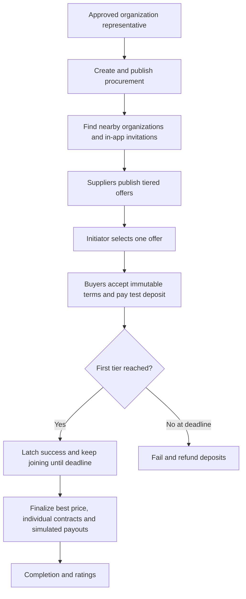

# Seasonal group snow-removal procurement

Owner: project maintainer. Housing associations combine nearby demand into one supplier-selected seasonal order. The first price tier defines the success threshold; later tiers lower the gross per-association price.

## Flow

## Rules

- Buyer organizations are housing associations; one seasonal snow-removal category in Mustamäe. The organization primary address supplies the procurement center. Radius defaults to 500 m and is configurable. Nearby search uses WGS84 coordinates.
- Only buyers inside the configured geographic radius may commit, except the initiator.
- Authentication is local email/password. Organization membership needs admin approval. Invitations do not grant authority.
- Initiator selects one offer before commitments. Terms, service scope, tiers, fee and deposit freeze on the first pending commitment. One pending/active/contracted commitment per buyer per procurement.
- Supplier fixed EUR deposit cannot exceed the cheapest tier price. All prices are supplier-entered gross seasonal prices. Buyers confirm authority and the common service scope.
- Only confirmed paid ACTIVE commitments count. Success latches exactly once. Best achieved tier never regresses after success. Joining stays open until deadline.
- Before success, withdrawal triggers a full immediate test refund. After success it forfeits the deposit; success history remains.
- At deadline, failed groups refund all captured deposits. Successful groups get one contract per continuing buyer, final price snapshot, gross deposit credit and remaining direct-invoice balance. Retained deposits are distributed 4% platform fee (nearest cent), remainder supplier share.
- Admin supplier cancellation refunds all captured deposits, including forfeitures; reverse prior simulated payouts and fees. Preserve snapshots, historical success and audit/ledger records.
- Serialize payment, withdrawal and deadline finalization with a procurement row lock. Late capture after withdrawal/deadline records a deposit and corresponding refund without counting it. Duplicate payment transactions/events never produce duplicate money or success.
- After finalization, a buyer may withdraw from an ACTIVE contract and forfeit the deposit; the contract becomes CANCELLED. Completed contracts cannot be withdrawn. Completion of all remaining contracts marks the procurement COMPLETED.
- Invitations are durable in-app records; no emails are sent. Contacts are private. All payments/payouts are visibly TEST transactions.

## Agreement history and import feedback

Acceptance history and final contracts present the preserved agreement in Estonian: organization identities and addresses, service specification, frozen supplier terms, joining deadline, price tiers and test-payment labeling. Acceptance time and confirmations remain distinct from the final price, deposit credit and invoice balance. The display uses the stored snapshot, so later profile changes or cancellation do not rewrite the agreement. Technical JSON is not the buyer/supplier history view.

Approved viewers can read their organization invitations and open the procurement, but only an approved representative or administrator sees response actions. The UI explains read-only access; invitations do not grant representation.

CSV preview errors identify the affected row and field in Estonian, with a useful correction for registry code, name, organization type, address, coordinates or email. Whole-file validation and atomic import behavior remain unchanged.

## Definition of Done

All rules have API/integration coverage; buyer/supplier/admin flows have browser coverage; build and static analysis pass; operations and API docs match behavior.
