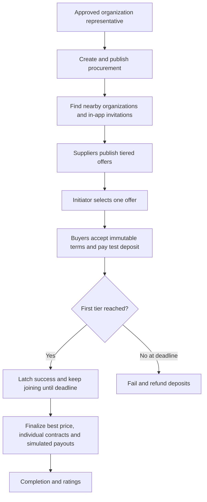

# Group service procurement

Owner: project maintainer. Housing associations combine nearby demand into one supplier-selected service order. The first price tier defines the success threshold; later tiers lower the gross per-association price.

## Flow

## Rules

- Buyer organizations are housing associations; the five demo service categories in Mustamäe: snow removal, pest control, energy certificates, branch cleanup and a free-form service. The organization primary address supplies the procurement center. Radius defaults to 500 m and is configurable. Nearby search uses WGS84 coordinates.
- Only buyers inside the configured geographic radius may commit, except the initiator.
- Authentication is local email/password. Organization membership needs admin approval. Invitations do not grant authority.
- Initiator selects one offer before commitments. Terms, service scope, tiers, fee and deposit freeze on the first pending commitment. One pending/active/contracted commitment per buyer per procurement.
- Supplier fixed EUR deposit cannot exceed the cheapest tier price. All prices are supplier-entered gross prices for the complete described service per association; snow removal uses a seasonal total. Buyers confirm authority and the common service scope.
- Only confirmed paid ACTIVE commitments count. Success latches exactly once. Best achieved tier never regresses after success. Joining stays open until deadline.
- Before success, withdrawal triggers a full immediate test refund. After success it forfeits the deposit; success history remains.
- At deadline, failed groups refund all captured deposits. Successful groups get one contract per continuing buyer, final price snapshot, gross deposit credit and remaining direct-invoice balance. New agreements charge the supplier 10% of the retained deposit, with no minimum, independent of final service price or participant tier; the remaining 90% is allocated to the supplier. The gross fee includes VAT if applicable. A positive deposit cannot exceed the cheapest tier price. Post-success retained withdrawals use the same frozen deposit percentage. Existing frozen agreements keep their stored policy: the original deposit rate or ADR 0005's contract-based percentage/minimum. See [ADR 0006](../ADR/0006-deposit-service-fee.md).
- Admin supplier cancellation refunds all captured deposits, including forfeitures; reverse prior simulated payouts and fees. Preserve snapshots, historical success and audit/ledger records.
- Serialize payment, withdrawal and deadline finalization with a procurement row lock. Late capture after withdrawal/deadline records a deposit and corresponding refund without counting it. Duplicate payment transactions/events never produce duplicate money or success.
- After finalization, a buyer may withdraw from an ACTIVE contract and forfeit the deposit; the contract becomes CANCELLED. Completed contracts cannot be withdrawn. Completion of all remaining contracts marks the procurement COMPLETED.
- Invitations are durable in-app records; no emails are sent. Contacts are private. All payments/payouts are visibly TEST transactions.

## Agreement history and import feedback

Acceptance history and final contracts present the preserved agreement in Estonian: organization identities and addresses, service specification, frozen supplier terms, joining deadline, price tiers and test-payment labeling. Acceptance time and confirmations remain distinct from the final price, deposit credit and invoice balance. The display uses the stored snapshot, so later profile changes or cancellation do not rewrite the agreement. Technical JSON is not the buyer/supplier history view.

Approved viewers can read their organization invitations and open the procurement, but only an approved representative or administrator sees response actions. The UI explains read-only access; invitations do not grant representation.

CSV preview errors identify the affected row and field in Estonian, with a useful correction for registry code, name, organization type, address, coordinates or email. Whole-file validation and atomic import behavior remain unchanged.

## Mailbox and visible next actions

The in-app demo mailbox shows durable procurement invitations and lifecycle messages in Estonian. No external email is sent. Each approved organization representative sees messages for their organizations; approved viewers may read invitations and general messages but cannot respond on behalf of an organization or see restricted financial messages. Administrators may inspect all messages. Reading is recorded per user, survives logout/restart, and does not grant organization authority. Repeated invitation sends and replayed financial operations must not create duplicate messages. Existing seeded invitations appear in the mailbox without resetting pilot data.

Messages link to the relevant procurement or contract. Invitation messages retain the existing accept/decline operations and explicitly say that accepting is separate from joining/paying. Supplier publication notifies the initiator, offer selection notifies the supplier and invited buyers, success and finalization notify involved organizations, and failure/cancellation explain test refunds. Financial messages remain labeled TEST.

The procurement page presents the process and next action above secondary details: publish a draft, find/invite neighbors, receive/choose an offer, confirm participation and test payment, wait for the joining deadline, then review the contract and complete/rate the service. The next action depends on lifecycle and approved organization role. Buttons open/scroll to the actual form or map; important forms do not require guessing a hidden tab. Terminal or expired states show their status and appropriate available history. The neighbor demo account buyer2@demo.test is a visible demo-login choice with password Demo2026!.

## Versioned service forms

Use the five types and question definitions in the retained Uhishange_vorm.html: snow (Lumekoristus), pest (Kahjuritõrje), energy (Energiamärgis), branches (Okste koristamine), other (Muu teenus – vabas vormis). Creation selects the type and shows its fields plus shared location, access conditions, desired date and pricing preference. Snow hauling requires snow-storage details; regular pest maintenance requires frequency; cutting branches requires its work description. Changing type or hiding a question clears its stale answers. Required fields, choices, numeric limits, dates and conditional visibility are validated on the server. A unit-price preference still requires the supplier's gross total for the complete service per association.

Persist new requests as {formId,version,answers} in the existing JSONB spec and copy that complete value into frozen acceptance/final agreements. Version 1 definitions remain stable for historical rendering; introduce a new version for future incompatible questions. Continue accepting and rendering existing unversioned SnowSpec records and snapshots. All invitation, pricing-tier, commitment, TEST deposit, refund, fee and deadline rules remain unchanged. Four additional fictional, idempotently seeded procurements demonstrate the new types in existing databases without resetting data. Category badges/filter and neutral product wording make each service discoverable.

Acceptance: create all five types through the API; reject unknown versions, hidden/unknown fields, invalid options/dates and missing conditional answers; preserve legacy data and frozen non-snow specifications; exercise non-snow creation and procurement workflows on desktop/mobile; seed upgrades remain idempotent.

## Definition of Done

All rules have API/integration coverage; buyer/supplier/admin flows have browser coverage; build and static analysis pass; operations and API docs match behavior.
